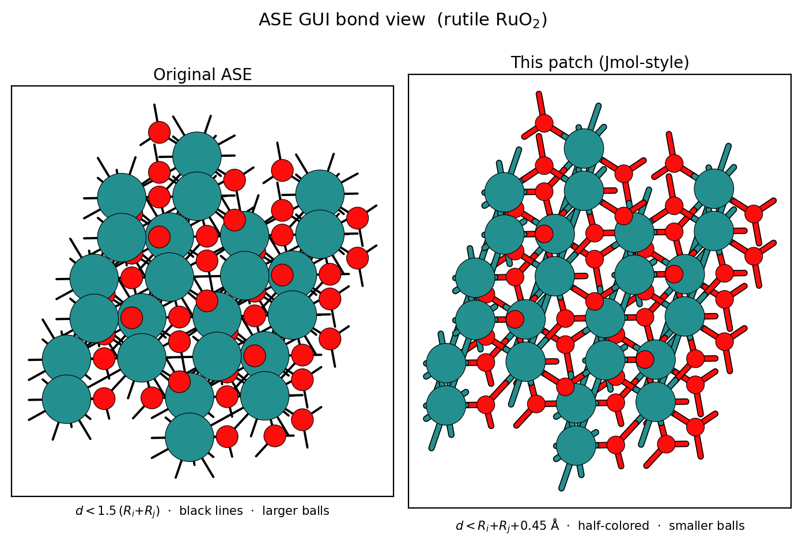

# ase-gui-jmol-bonds

Make the ASE GUI (`ase gui`, **Ctrl+B**) draw bonds the way Jmol does:
half-colored sticks with a Jmol-style bond rule, instead of plain black lines.

Two ways to apply it, same result:

- **`patch_ase_bond_colors.py`** — edits the installed `ase/gui/view.py` and
  `ase/gui/ui.py` **in place** (persistent; a `conda`/`pip` reinstall reverts it).
- **`ase_gui_jmol_launcher.py`** — applies the same edits **in memory** and opens
  the GUI; writes **nothing** to disk, re-patches every run (survives upgrades).

Both are **idempotent**, match code by content (not line numbers) so they work
across ASE **3.21–3.26**, and encode the same set of edits. The file patcher
makes a one-time `.orig` backup of each file.



*Left: stock ASE (black lines, larger balls, `d < 1.5·(Rᵢ+Rⱼ)`). Right: this
patch (half-colored sticks, smaller balls, `d < Rᵢ+Rⱼ+0.45 Å`). Regenerate with
`python compare_views.py [structure]` — defaults to a self-contained rutile RuO₂
demo cell.*

## What it changes

1. **Half-colored bonds** — each half of a bond takes the color of the atom on
   that end (e.g. red O half, gray Ru half), following the active colormode.
2. **Black outline + round caps** on each stick (Jmol ball-and-stick look).
3. **Stick width** `max(1, int(scale * 0.18))`.
4. **Smaller balls** in bond mode (`0.65 → 0.5 ×` covalent radius), with the
   bond start offset shrunk to match so sticks meet the ball with no gap.
5. **Jmol bond rule** (see below).
6. **Slider-decoupled bonding** — the bond decision uses unscaled covalent
   radii, so it no longer shifts when you drag the atom-size slider.
7. `ui.py` `line()` gains `color` / `capstyle` parameters.

## Bonding rule

After patching, atoms *i* and *j* are bonded iff

```
d(i, j)  <  R_i + R_j + 0.45 Å
```

- `R` = ASE Cordero (2008) covalent radii (`ase.data.covalent_radii`), unscaled.
- `+0.45 Å` additive tolerance, implemented as `NeighborList(covalent_radii + 0.225)`
  (the neighbor list bonds when `d < cutoff_i + cutoff_j`, so each atom carries
  half the tolerance).
- strict `<`, `skin = 0`, `self_interaction = False` (an atom may still bond to
  its own periodic image). No lower bound.

This replaces ASE's stock multiplicative rule `d < 1.5·(R_i + R_j)`, which
over-bonds large/metal atoms. Examples: Ru–Ru if `d < 3.37 Å`, Ru–O if
`d < 2.57 Å`, O–O if `d < 1.77 Å`.

## Usage

Run either script with the **same Python that runs `ase gui`**. To find it:

```sh
head -1 "$(which ase)"
```

### Persistent (edit installed files)

```sh
# patch the ASE of THIS python
python patch_ase_bond_colors.py

# or point at a specific install
python patch_ase_bond_colors.py /path/to/site-packages/ase

# undo (restore the .orig backups)
python patch_ase_bond_colors.py --revert
```

Then reopen `ase gui <file>` and press **Ctrl+B**.

### In memory (no disk changes)

```sh
# opens the real ASE GUI with bonds shown; nothing written to disk
python ase_gui_jmol_launcher.py STRUCTURE

# verify the bond rule without opening a window
python ase_gui_jmol_launcher.py --check
```

## Tuning

Edit the constants near the top of `patch_ase_bond_colors.py`:

| Constant            | Controls                          | Default              |
|---------------------|-----------------------------------|----------------------|
| `VIEW_LW_NEW`       | stick width                       | `0.18 × scale`       |
| `VIEW_BALL_NEW`     | ball size in bond mode            | `0.5 ×` covalent     |
| `VIEW_BOND_NEW`     | bond tolerance (half, per atom)   | `+0.225` (→ 0.45 Å)  |

Re-run the script after editing.

## Caveats

- A `conda`/`pip` reinstall or upgrade of ASE overwrites the patched files —
  just re-run the script.
- Affects the interactive GUI canvas only. The offline render export
  (`ase/gui/render.py`: EPS / PNG / POV-Ray) is **not** patched.
- Two deliberate differences from stock Jmol remain: the radius **table**
  (ASE Cordero vs Jmol's OpenBabel/BODR — agrees to within ~0.08 Å for common
  catalysis elements), and no `minBondDistance` lower bound (only matters for
  near-coincident atoms).

## Requirements

ASE (tested 3.21–3.26). No other dependencies.
